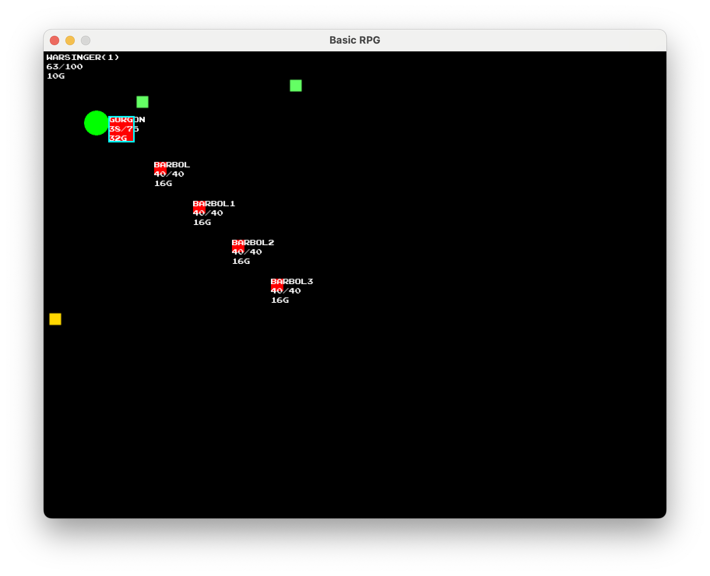
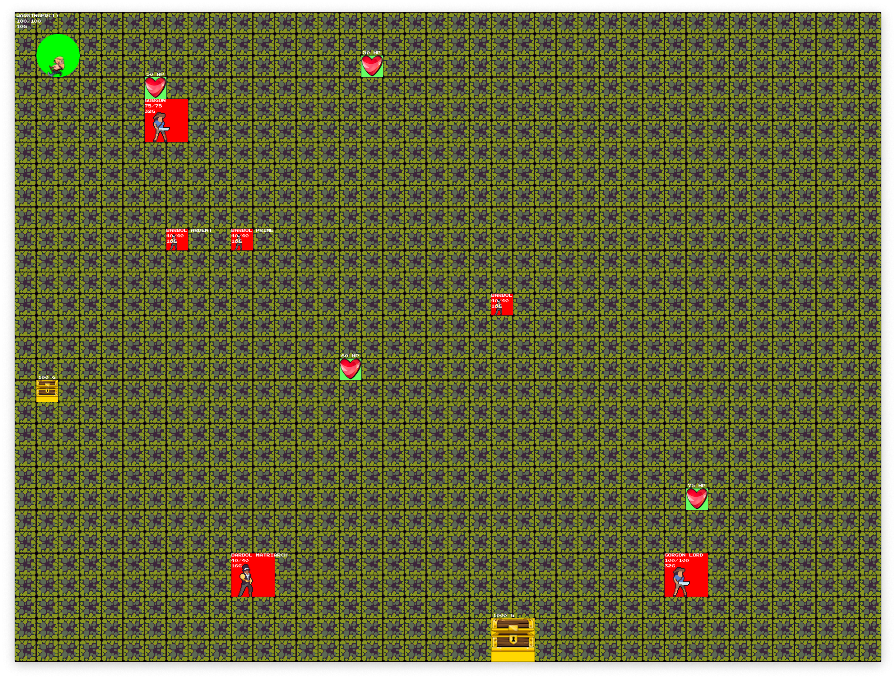

# golang-rpg
Basic RPG written in Go for fun and learning

Attack mosters. Pick up loot. Save the princess?

## Instructions
* Arrow Keys to move
* A key to attack monster when in range
* U key to pick up loot when in range
* R key to reset the game
* F to toggle full screen
* Q key to quit the game

## TODO
* Map
* Monster movement
* Attacker face defender
* ~~Vary monster images~~
* Add real monster images
* Spawning monsters
* Randomize damage (damage dice)
* Add weapons and armor
* ~~Background image~~
* Smooth out drawing during movement
* Cache image loading
* ~~Support variable sprite frame count~~
* Add unit tests

## Screenshots


## Build and verify

Requires Go 1.27.3 or newer. Automatic Go toolchain selection can download the version declared in go.mod.

```sh
go mod download
go mod verify
go vet ./...
go test ./...
go build -o build/golang-rpg .
go run .
```

Run from the repository root: the current desktop application loads `config/` and `assets/` from the working directory. The browser milestone will embed/package these resources. On Linux, install the [Ebitengine graphics dependencies](https://ebitengine.org/en/documents/install.html) and use a display (or Xvfb for headless tests).

A WebAssembly compilation check is available:

```sh
GOOS=js GOARCH=wasm go build -o build/golang-rpg.wasm .
```

In PowerShell, set `$env:GOOS = 'js'` and `$env:GOARCH = 'wasm'` before the build, then remove those variables afterward. Compilation alone does not make a working web app: browser resource loading, input, save behavior and a launcher are tracked in #4. Expanded tests and contributor documentation are tracked in #2 and #3. The existing test baseline exercises 11.1% of statements; graphical gameplay is not covered by that figure.
